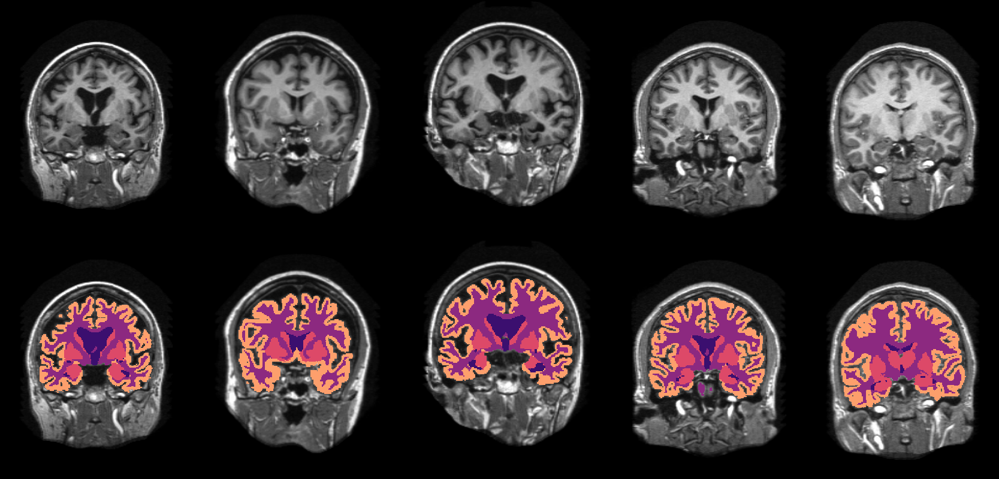
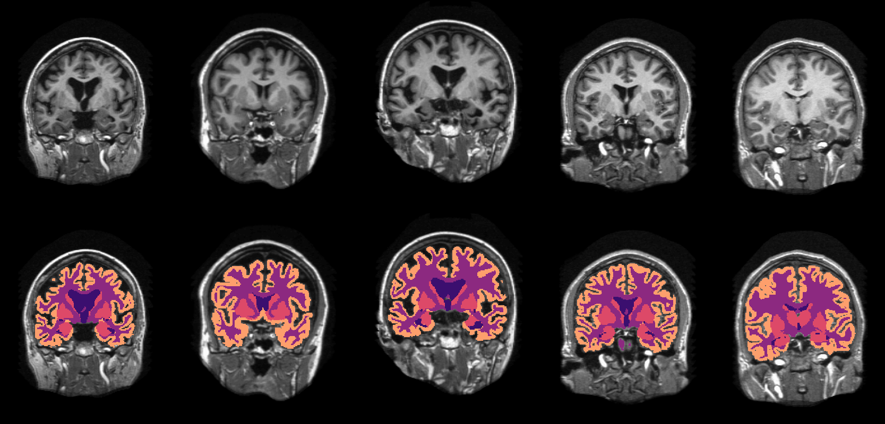
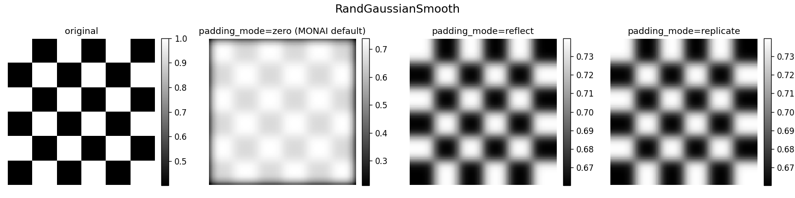
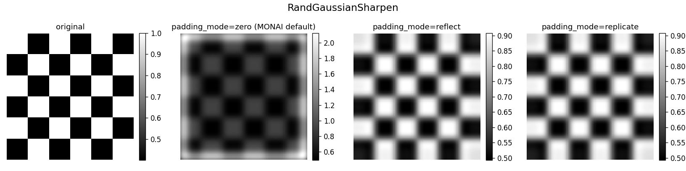

# Gallery

Each GIF shows one augmentation applied to 5 OASIS [neurite](https://github.com/adalca/medical-datasets/blob/master/neurite-oasis.md) T1 brain MRI subjects. The first frame is the original; the second is the augmented output. Top row: volume; bottom row: volume with segmentation overlay.

All transforms below use `prob=1.0` so the effect is visible on every subject. For geometric transforms applied to both volume and segmentation, `mode={"vol": "bilinear", "seg": "nearest"}` ensures the segmentation is resampled with nearest-neighbor interpolation.

## Geometric

### `batchaug.RandRotate90d(keys=["vol", "seg"], prob=1.0, max_k=3, spatial_axes=(0, 1))`

### `batchaug.RandAxisFlipd(keys=["vol", "seg"], prob=1.0)`

### `batchaug.RandFlipd(keys=["vol", "seg"], prob=1.0)`

### `batchaug.RandRotated(keys=["vol", "seg"], prob=1.0, range_x=1.0, range_y=1.0, range_z=1.0, mode={"vol": "bilinear", "seg": "nearest"})`

### `batchaug.RandZoomd(keys=["vol", "seg"], prob=1.0, min_zoom=0.6, max_zoom=1.4, mode={"vol": "bilinear", "seg": "nearest"})`

### `batchaug.RandAffined(keys=["vol", "seg"], prob=1.0, rotate_range=0.5, shear_range=0.2, translate_range=10, scale_range=0.2, mode={"vol": "bilinear", "seg": "nearest"})`

### `batchaug.Rand3DElasticd(keys=["vol", "seg"], prob=1.0, sigma_range=(12.0, 25.0), magnitude_range=(900.0, 1500.0), mode={"vol": "bilinear", "seg": "nearest"})`

## Intensity

### `batchaug.RandGaussianNoised(keys=["vol"], prob=1.0, mean=0.0, std=(0.05, 0.4))`

### `batchaug.RandRicianNoised(keys=["vol"], prob=1.0, std=0.2)`

### `batchaug.RandAdjustContrastd(keys=["vol"], prob=1.0, gamma=(0.5, 2.5))`

### `batchaug.RandGaussianSmoothd(keys=["vol"], prob=1.0, sigma_x=(2.0, 4.0), sigma_y=(2.0, 4.0), sigma_z=(2.0, 4.0))`

### `batchaug.RandGaussianSharpend(keys=["vol"], prob=1.0)`

### `batchaug.RandSimulateLowResolutiond(keys=["vol"], prob=1.0, zoom_range=(0.33, 0.5))`

### `batchaug.RandBiasFieldd(keys=["vol"], prob=1.0, degree=3, coeff_range=(0.0, 0.3))`

### `batchaug.RandGibbsNoised(keys=["vol"], prob=1.0, alpha=(0.5, 0.8))`

### `batchaug.RandScaleIntensityd(keys=["vol"], prob=1.0, factors=0.9)`

### `batchaug.RandShiftIntensityd(keys=["vol"], prob=1.0, offsets=0.3)`

### `batchaug.RandStdShiftIntensityd(keys=["vol"], prob=1.0, factors=3.0)`

### `batchaug.RandScaleIntensityFixedMeand(keys=["vol"], prob=1.0, factors=0.5)`

### `batchaug.RandConvd(keys=["vol"], prob=1.0, kernel_sizes=[3, 5, 7], mixing=False, rand_bias=True)`

## RandSimulateLowResolution mode comparison

All use `zoom_range=(0.33, 0.5)` with the same random seed so frames are directly comparable. See [MONAI Defaults vs Recommended Settings](../README.md#randsimulatelowresolution--spatial-shift-from-convention-mismatch) for context on the spatial shift these combos exhibit.

### `downsample_mode="nearest", upsample_mode="trilinear"` (MONAI default)

### `downsample_mode="nearest-exact", upsample_mode="trilinear"`

### `downsample_mode="trilinear", upsample_mode="nearest-exact"`

## Gaussian smooth/sharpen padding mode comparison

Static panels on a synthetic coarse checkerboard (bright to the boundary), with sigma fixed and the same seed so the only difference between panels is the padding mode. Zero-padding (MONAI default) produces a dark halo at the edges (an inverted bright halo for sharpen); `"reflect"`/`"replicate"` remove it. See [MONAI Defaults vs Recommended Settings](../README.md#randgaussiansmooth--randgaussiansharpen--dark-edge-halo-from-zero-padding) for context. Generated by [examples/figs_padding/make_padding_mode_figs.py](../examples/figs_padding/make_padding_mode_figs.py).

### `batchaug.RandGaussianSmoothd` — `padding_mode` ∈ {None (zero), "reflect", "replicate"}

### `batchaug.RandGaussianSharpend` — `padding_mode` ∈ {None (zero), "reflect", "replicate"}

